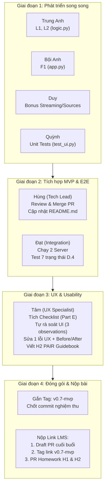

# Phân công nhiệm vụ Lab 07 — Nhóm 7 thành viên (Phạm vi: Phần C trở đi)

**Môn học:** CSC10014  
**Chủ đề:** *A User Interface for the Assistant* — Streamlit, API Integration, Testing & Usability  
**Thành viên:** Duy, Trung Anh, Bội Anh, Quỳnh, Hùng, Đạt, Tâm  
**Tài liệu tham chiếu:** `CSC10014_2026_Lab07_UI_Fullstack_Tutorial.docx.pdf` (Part C đến Hết) và mã nguồn tại `lab07_lecturer_given/starter`.  

> [!IMPORTANT]
> **CÁC ĐIỀU CHỈNH PHẠM VI THEO YÊU CẦU:**
> 1. **BỎ QUA PART A & B:** Không làm bài tập U1–U4 trong thư mục `practice/hello_streamlit.py`. Chỉ làm việc trong `lab07/starter/` và `lab07/worksheets/`.
> 2. **BỎ QUA BƯỚC TEST NGƯỜI NGOÀI NHÓM (H1):** Bỏ qua 3 bước (1. Tìm người ngoài nhóm; 2. Giao bài test 10 phút; 3. Ngồi quan sát ghi chú). Thay vào đó, **tự đóng vai người dùng / rà soát nội bộ (self-evaluation)** để tìm ra 3 điểm hạn chế/bất cập trong UI/hệ thống, điền vào `user_test_observations.md`, sau đó sửa 1 điểm bất cập (kèm ảnh before/after) và làm H2.
> 3. **ĐIỀU PHỐI NHÂN LỰC:** Thành viên **Duy** phụ trách **Nghiên cứu & Triển khai tính năng Bonus (Part D.5 - Streaming / Nâng cấp UI trích dẫn nguồn)** để nhóm đạt điểm tối đa (+1 điểm bonus).

---

## 1. Bảng phân công tổng quan mới

| Thành viên | Vai trò | Nhiệm vụ chính (Từ Part C trở đi) | File/phạm vi phụ trách | Đầu ra bắt buộc |
|---|---|---|---|---|
| **Trung Anh** | UI Business Logic | Hoàn thành L1 và L2 | `starter/ui/logic.py` | Định dạng nguồn (L1) và ghi chú trạng thái (L2), PR riêng |
| **Bội Anh** | Feedback UI | Hoàn thành F1 (Nút 👎) | `starter/ui/app.py` | Nút dislike hoạt động, toast thông báo, ẩn sau khi vote, PR riêng |
| **Duy** | Bonus & UI Enhancement | Nghiên cứu & triển khai Bonus (Part D.5) | `starter/ui/app.py`, `ui/logic.py` | Streaming typing animation hoặc bộ hiển thị nguồn trực quan (accordion/expander), PR Bonus |
| **Quỳnh** | Automated Testing | Bổ sung unit tests & regression suite | `starter/tests/test_ui.py` | Bao phủ biên logic, mock API client các mã lỗi, PR test |
| **Đạt** | API Integration & E2E | Kiểm chứng 2 server và 7 trạng thái D.4 | `starter/ui/api_client.py`, E2E | Báo cáo kiểm thử 7 kịch bản E2E + bằng chứng ảnh/log |
| **Tâm** | UX & Usability | Hoàn thành Checklist (Part E) & Homework (H1, H2) | `worksheets/*.md` | Checklist 10 mục, 3 quan sát UI tự rà soát, 1 bản fix UX có ảnh before/after, 2 câu H2 |
| **Hùng** | Tech Lead & Integration | Review PR, hợp nhất code, README, gắn Tag | `starter/README.md`, repo nhóm | MVP chạy xuyên suốt 2 server, README chuẩn, Tag `v0.7-mvp` |

---

## 2. Công việc chi tiết từng thành viên

### 2.1. Trung Anh — UI Business Logic (Part D.1 & D.2: L1, L2)
- **Tham chiếu:** PDF trang 11 (Part D.1, D.2).
- **File phụ trách:** `lab07/starter/ui/logic.py`.
- **Nhiệm vụ cụ thể:**
  1. **L1 — `format_sources(sources)`:**
     - Nếu `sources` rỗng (`[]`): trả về chuỗi rỗng `""`.
     - Nếu có nguồn: trả về định dạng `"Sources: " + "; ".join(f"{s['id']} — {s['title']}" for s in sources)`.
  2. **L2 — `status_note(result)`:**
     - `result.escalate == True`: trả về `"I could not find this in the official documents. A staff member can help: Training Office, room I.101."`
     - `result.degraded == True`: trả về `"Shown directly from the source document (the AI helper was unavailable)."`
     - Bình thường: trả về `None`.
     - *Lưu ý:* Luôn kiểm tra `escalate` trước `degraded` để đảm bảo đúng thứ tự ưu tiên.
- **Kiểm thử:** Chạy `pytest -q tests/test_ui.py` đạt pass.
- **DoD:** Hàm không còn `NotImplementedError`, đúng chính xác từng ký tự theo yêu cầu đề bài, PR riêng sạch sẽ.

---

### 2.2. Bội Anh — Feedback UI (Part D.3: F1)
- **Tham chiếu:** PDF trang 11–12 (Part D.3).
- **File phụ trách:** `lab07/starter/ui/app.py`.
- **Nhiệm vụ cụ thể:**
  1. Đọc luồng hiển thị lịch sử chat trong `app.py`, tìm vị trí nút 👍 đã dựng sẵn ở cột `c1`.
  2. **F1:** Bổ sung nút 👎 ở cột `c2`:
     ```python
     if c2.button("👎", key=f"down{i}"):
         client.send_feedback(rid, -1)
         st.session_state.rated.add(rid)
         st.toast("Thanks — we will look at this answer.")
     ```
  3. Kiểm tra tính năng:
     - Khóa nút bằng `key=f"down{i}"` để tránh lỗi `DuplicateWidgetID`.
     - Gửi đúng `rating=-1` cùng `request_id`.
     - Sau khi người dùng vote 👍 hoặc 👎, các nút đánh giá của tin nhắn đó phải ẩn đi (do kiểm tra `rid not in st.session_state.rated`).
- **DoD:** Nút 👎 xuất hiện cạnh nút 👍, nhấn thành công gửi request API, hiện toast thông báo và ẩn nút, có PR độc lập.

---

### 2.3. Duy — Bonus Feature & UI Enhancements (Part D.5: Bonus +1 điểm)
- **Tham chiếu:** PDF trang 12 (Part D.5) và trang 16 (Grading: Bonus +1).
- **File phụ trách:** `lab07/starter/ui/app.py`, `ui/logic.py` (nhánh `feature/bonus-streaming-or-sources`).
- **Nhiệm vụ cụ thể (Chọn 1 trong 2 hoặc kết hợp cả 2 hướng bonus đề bài gợi ý):**
  1. **Hướng 1 — Hiển thị hiệu ứng Streaming ("typing..." animation):**
     - Áp dụng `st.write_stream` hoặc mô phỏng stream generator cho câu trả lời của trợ lý thay vì chỉ dùng `st.spinner("Thinking…")`, giúp trải nghiệm đọc mượt mà hơn.
  2. **Hướng 2 — Nâng cấp hiển thị nguồn tài liệu (Better Sources Display):**
     - Thay vì chỉ hiển thị một dòng text caption đơn điệu bên dưới câu trả lời, gom nguồn vào `st.expander("📚 Tham khảo nguồn tài liệu")` hoặc hiển thị dạng badge/card có highlight ID trích dẫn (`H26#5.3`), giúp giao diện chuyên nghiệp hơn.
  3. Đảm bảo code bonus không phá vỡ logic gốc của Trung Anh và Bội Anh.
- **DoD:** Tính năng bonus hoạt động trực quan trên trình duyệt, không gây lỗi khi chạy unit test, có video/ảnh GIF demo và PR riêng.

---

### 2.4. Quỳnh — Automated Testing & Quality Assurance
- **Tham chiếu:** PDF trang 11, 16 và file `starter/tests/test_ui.py`.
- **File phụ trách:** `lab07/starter/tests/test_ui.py` (và tạo thêm test cases mới nếu cần).
- **Nhiệm vụ cụ thể:**
  1. Đọc bộ test mẫu hiện có (đang thiếu nhiều ca kiểm thử biên).
  2. Bổ sung test cases:
     - `validate_input`: chuỗi rỗng `""`, chỉ có khoảng trắng `"   "`, chuỗi 2000 ký tự (hợp lệ), chuỗi 2001 ký tự (báo lỗi độ dài).
     - `format_sources`: danh sách rỗng, 1 nguồn, nhiều nguồn ghép nối bằng dấu chấm phẩy `; `.
     - `status_note`: khi `escalate=True`, khi `degraded=True`, khi cả hai cùng `True` (ưu tiên `escalate`), khi cả hai `False`.
     - `AssistantClient`: mock server trả về 200, 422, 429, 500, lỗi Timeout, lỗi mất kết nối backend (`ConnectError`).
     - Feedback API: mock gửi `rating=1` và `rating=-1`.
  3. Đóng vai trò QA kiểm tra chéo (regression test) trước khi Hùng merge bất kỳ PR nào.
- **DoD:** File `tests/test_ui.py` được mở rộng toàn diện, chạy lệnh `pytest -q` đạt pass 100%, có output test trong PR.

---

### 2.5. Đạt — API Integration & End-to-End Testing (Part C & D.4)
- **Tham chiếu:** PDF trang 9 (Part C) và trang 12 (Part D.4).
- **File phụ trách:** Kiểm thử tích hợp hệ thống, kiểm tra `starter/ui/api_client.py`.
- **Nhiệm vụ cụ thể:**
  1. Nắm vững kiến trúc 2 server độc lập:
     - Terminal 1: API backend chạy tại cổng `8000` (`uvicorn assistant_api.main:create_app --factory`).
     - Terminal 2: UI Streamlit chạy tại cổng `8501` (`streamlit run ui/app.py`).
  2. Kiểm thử và xác nhận đủ **7 kịch bản bắt buộc tại Part D.4**:
     - *Kịch bản 1:* Bấm vào các câu hỏi gợi ý ở Sidebar -> Câu hỏi và câu trả lời hiển thị đúng.
     - *Kịch bản 2:* Hỏi `"Can I register my thesis with 118 credits?"` -> Trả về câu trả lời kèm `Sources: H26#5.3 — ...`.
     - *Kịch bản 3:* Hỏi câu hỏi ngoài tài liệu (vd: `"what is the capital of France"`) -> Hiển thị thông báo escalate chuyển tiếp đến Training Office, phòng I.101.
     - *Kịch bản 4:* Nhấn Enter với ô nhập rỗng -> Streamlit tự chặn, không gửi request rác đến backend.
     - *Kịch bản 5:* Nhấn nút 👍 và 👎 -> Hiển thị thông báo toast cảm ơn, các nút ẩn đi.
     - *Kịch bản 6:* Tắt Backend API (Ctrl+C ở Terminal 1) rồi đặt câu hỏi -> Giao diện hiển thị cảnh báo *"The assistant backend is not reachable..."*, không bị crash trang (trắng màn hình).
     - *Kịch bản 7:* Giả lập / kiểm tra khi API quá tải hoặc trả về 429/500 -> Hiển thị câu thông báo thân thiện ("fail politely").
- **DoD:** Bảng báo cáo nghiệm thu 7 kịch bản kèm ảnh chụp màn hình minh chứng từng trường hợp.

---

### 2.6. Tâm — UX Usability Testing (Part E & Homework H1, H2)
- **Tham chiếu:** PDF trang 13 (Part E) và trang 15 (Homework H1, H2).
- **File phụ trách:** `lab07/worksheets/usability_checklist.md`, `lab07/worksheets/user_test_observations.md`.
- **Nhiệm vụ cụ thể:**
  1. **Part E (Usability Checklist):**
     - Mở `usability_checklist.md`, rà soát đúng 10 tiêu chí (giới thiệu tính năng, xử lý input rỗng/dài, trạng thái "Thinking...", trích dẫn nguồn, thông báo escalate, thông báo mất backend, nút 👍/👎, thông báo rõ đây là AI, độ tương phản/dễ đọc, hiển thị co giãn trên màn hình điện thoại).
     - Tích chọn `[x]` sau khi kiểm chứng thực tế.
  2. **Homework H1 (Tự rà soát UI & Sửa 1 lỗi UX — Bỏ qua việc tìm người ngoài nhóm test 10 phút):**
     - **Bỏ qua các bước:** (1) Tìm người ngoài nhóm; (2) Giao bài test 10 phút; (3) Ngồi quan sát ghi chú.
     - **Thay bằng quy trình rà soát trực tiếp (Heuristic / Self-Evaluation):** Tự đóng vai người dùng mới trải nghiệm app, thử các luồng hỏi đáp để tìm ra **3 điểm bất cập / gây hiểu lầm / chưa thuận tiện** trong giao diện hoặc phản hồi của hệ thống.
     - Điền 3 bất cập này vào bảng trong `lab07/worksheets/user_test_observations.md` (What happened, What expected, Why system caused it, Fix idea).
     - Chọn **1 vấn đề** khả thi nhất để sửa trực tiếp trên giao diện (phối hợp với Bội Anh hoặc Duy), commit kèm ảnh chụp trước và sau khi sửa (**Before/After screenshot**).
  3. **Homework H2 (Google PAIR Guidebook):**
     - Đọc 2 phần *Feedback + Control* và *Errors + Graceful Failure* tại [Google PAIR Guidebook](https://pair.withgoogle.com/guidebook).
     - Viết 2 câu đúc kết: 1 ý tưởng đã áp dụng trong Lab 7, 1 ý tưởng đề xuất cải tiến thêm.
- **DoD:** Cả 2 file markdown trong `worksheets/` được điền hoàn chỉnh, có ảnh minh chứng before/after cho bản sửa H1, PR nộp bài.

---

### 2.7. Hùng — Tech Lead & Project Integration
- **Tham chiếu:** PDF trang 14 (Team Integration) và trang 16 (How to Submit).
- **File phụ trách:** `lab07/starter/README.md`, quản lý branch/PR trên repository nhóm.
- **Nhiệm vụ cụ thể:**
  1. Khởi tạo repository nhóm, thiết lập branch bảo vệ, phổ biến quy tắc commit và branching.
  2. Review các PR từ Trung Anh (Logic), Bội Anh (Feedback), Duy (Bonus), Quỳnh (Test), Tâm (Worksheets).
  3. Giải quyết merge conflict, bảo đảm chỉ có một phiên bản UI chuẩn duy nhất được hợp nhất.
  4. Cập nhật `starter/README.md`:
     - Hướng dẫn cài đặt virtual environment và dependencies (`requirements.txt`).
     - Hướng dẫn cấu hình `.env` từ `.env.example`.
     - Lệnh chạy 2 server đồng thời (Terminal 1: Uvicorn API; Terminal 2: Streamlit UI).
     - Lệnh chạy pytest.
  5. Cùng Đạt và Quỳnh chạy nghiệm thu toàn diện (End-to-End MVP).
  6. Gắn tag **`v0.7-mvp`** trên commit hoàn thiện đạt chuẩn.
  7. Thu thập link PR và link Tag gửi cho cả nhóm nộp lên LMS.
- **DoD:** Hệ thống hợp nhất chạy mượt mà, README chuẩn xác, tạo thành công tag `v0.7-mvp`, tổng hợp link nộp bài đúng hạn.

---

## 3. Quy trình thực hiện & Luồng tích hợp (Workflow)



---

## 4. Bảng tiêu chí chấm điểm và đối chiếu trách nhiệm

| Phần trong Lab | Tiêu chí đánh giá | Điểm gốc | Thành viên phụ trách chính |
|---|---|:---:|---|
| **Part D.1 & D.2** | L1, L2 tests pass | 2đ | **Trung Anh** |
| **Part D.3** | F1 hoạt động đúng trên trình duyệt | 1đ | **Bội Anh** |
| **Part D.4** | Đầy đủ 7 trạng thái hoạt động chính xác (bình thường, escalate, ngắt kết nối...) | 2đ | **Đạt** (+ Quỳnh kiểm thử tự động) |
| **Part E** | Hoàn thành 10 tiêu chí trong Usability Checklist | 1đ | **Tâm** |
| **Homework H1 & H2** | 3 quan sát UI tự rà soát + 1 bản sửa kèm ảnh before/after + 2 câu H2 | 2đ | **Tâm** (+ Duy/Bội Anh hỗ trợ fix UX) |
| **Bonus D.5** | Hiệu ứng streaming câu trả lời hoặc nâng cấp hiển thị nguồn trích dẫn trực quan | **+1đ** | **Duy** |
| **Team Integration** | README chuẩn khởi chạy 2 server, tag `v0.7-mvp` và điều phối nhóm | *Bắt buộc* | **Hùng** |
| **Tổng điểm hướng tới** | | **10 / 10 (+1 điểm thưởng = 11)** | **Cả nhóm phối hợp** |

---

## 5. Hạn nộp & Các mốc quan trọng (Deadlines)

1. **Cuối buổi thực hành (In-class deadline):**
   - Hoàn thành L1, L2, F1; bộ unit test pass; hoàn thành Usability checklist (Part E).
   - Nộp link PR (hoặc draft PR) lên hệ thống LMS.
2. **Trước 23:59 ngày trước buổi Lab 8:**
   - Hoàn tất tích hợp toàn bộ nhánh vào repo chính, README hoàn chỉnh, tạo tag `v0.7-mvp`.
   - Hoàn thành bài tập về nhà H1 (3 quan sát + 1 fix + ảnh minh chứng) và H2 (2 câu đọc hiểu PAIR).
   - Nộp link Tag và link PR hoàn thiện lên LMS.
