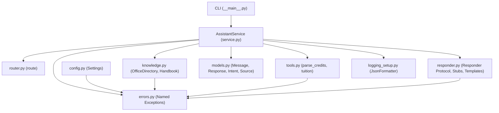

# Architecture Note: assistant_core

## H1 extension: help command

`Message(text="help")` and `Message(text="?")` route to `Intent.HELP`.
`AssistantService` returns a deterministic capability list with empty sources
and `degraded=False`; no responder is called. Exact command matching keeps
office questions containing `helpdesk` and longer fee/rule questions on their
existing routes. The public `handle(Message) -> Response` interface remains
unchanged. The existing fallback router also recognises help.

## 1. Overview and Target Architecture

`assistant_core` is a refactored Python package designed for high maintainability, testability, and clear separation of concerns. It transitions a monolithic script into a modular service with typed data models, deterministic business logic, safe environment-driven configuration, and structured logging.

### Component Architecture & Dependency Flow



> **Single Entry Point Rule**: Callers (CLI today, FastAPI backend in Lab 4, and UI in Lab 7) only interact directly with `AssistantService.handle(msg: Message) -> Response`.

---

## 2. Module Responsibilities (Part B.1)

| Module | Responsibility | Owner (Member) |
|---|---|---|
| `src/assistant_core/config.py` | Read configuration from environment variables and `.env`; validate settings with Pydantic | Member 2 |
| `src/assistant_core/errors.py` | Custom exception hierarchy rooted at `AssistantError` | Member 2 |
| `src/assistant_core/models.py` | Typed domain models: `Message`, `Response`, `Intent`, `Source` | Member 3 |
| `src/assistant_core/router.py` | Intent detection using deterministic rule matching | Member 3 |
| `src/assistant_core/knowledge.py` | Encapsulate CSV office directory and JSON handbook search | Member 4 |
| `src/assistant_core/tools.py` | Pure deterministic credit parsing and tuition calculation | Member 5 |
| `src/assistant_core/responder.py` | Interface/Protocol for response generation (`TemplateResponder`, `StubLLMResponder`) | Member 6 |
| `src/assistant_core/logging_setup.py` | Structured JSON log formatter ensuring no secret leaks | Member 6 |
| `src/assistant_core/service.py` | `AssistantService`: orchestrate routing, tools, knowledge, and responders | Member 1 |
| `src/assistant_core/__main__.py` | CLI entry point for command-line execution | Member 1 |
| `src/assistant_core/__init__.py` | Package versioning and public API exports | Member 1 |
| `tests/conftest.py` & Quality | Shared fixtures, integration tests, and QA gates | Member 7 |

---

## 3. Public Service Interface (Part B.2)

### Contract
```python
AssistantService.handle(msg: Message) -> Response
```

- **Request Model**:
  - `Message`:
    - `text`: `str` (1–2000 characters, validated by Pydantic)
    - `session_id`: `str` (defaults to `"local"`)

- **Response Model**:
  - `Response`:
    - `answer`: `str`
    - `intent`: `Intent` (Enum: `GREETING`, `FEE`, `OFFICE`, `RULE`, `UNKNOWN`)
    - `sources`: `list[Source]` (default `[]`)
    - `degraded`: `bool` (default `False`, set to `True` if a fallback responder was used)

- **Error Handling Policy**:
  - **Input validation errors**: Reject at boundary via Pydantic (`ValidationError` / `InvalidRequest`).
  - **Startup/Configuration errors**: Raise `ConfigError` or `DataError` fail-fast on startup.
  - **External / Provider failures**: Catch `ProviderError` internally inside `service.py`, fall back to `TemplateResponder`, and set `degraded=True` without crashing the caller.

---

## 4. Key Architectural Decisions (Part D.4)

1. **Deterministic Business Logic in `tools.py` (No LLM for Arithmetic)**
   - *Decision*: Fee parsing and tuition calculations are implemented as pure functions (`parse_credits`, `tuition`) in `tools.py`.
   - *Rationale*: Arithmetic must be exact and predictable. LLMs can hallucinate numeric values. Pure functions have no side effects, require no network I/O, and are straightforward to verify with parameterized unit tests.

2. **Decoupled LLM Behind `Responder` Protocol (Adapter Pattern)**
   - *Decision*: The LLM is abstracted behind a `Responder` Protocol with `TemplateResponder` and `StubLLMResponder` implementations.
   - *Rationale*: The test suite and CI can run offline, fast, and deterministically without external API dependencies or incurring costs. In Week 4, a real LLM provider can be plugged in without changing a single line of `service.py`.

3. **12-Factor Configuration via Environment Variables & `.env.example`**
   - *Decision*: All configurable values (tuition rates, data paths, log levels, API keys) are managed in `Settings` loaded from environment variables.
   - *Rationale*: Adheres to Twelve-Factor App factor III (Config). Prevents hardcoding secrets in source code or Git. `llm_api_key` has `repr=False` to prevent accidental logging. `.env.example` provides a documented template for all developers.

---

## 5. Team Git & Development Guidelines

1. **Branching Strategy**:
   - `main`: Protected branch.
   - Feature branches:
     - Member 1 (Duy): `feat/service-cli`
     - Member 2 (Hùng): `feat/config-errors`
     - Member 3 (Đạt): `feat/models-router`
     - Member 4 (Bội Anh): `feat/knowledge`
     - Member 5 (Quỳnh): `feat/tools`
     - Member 6 (Trung Anh): `feat/responder-logging`
     - Member 7 (Tâm): `test/integration-quality-gates`

2. **Peer Review Protocol ("Người trên review người dưới")**:
   Each member submits their PR according to the closed-loop review table:

   | Author (PR Owner) | Reviewer | Ownership Scope & Review Focus |
   |---|---|---|
   | **Duy** (`@johannguyen015`) | **Tâm** (`@benalexx007`) | `service.py`, `__main__.py`, `docs/architecture.md`, end-to-end integration |
   | **Hùng** (`@philip-kkk`) | **Duy** (`@johannguyen015`) | `config.py`, `errors.py`, `.env.example`, secret protection (Twelve-Factor III) |
   | **Đạt** (`@Thanhdat3010`) | **Hùng** (`@philip-kkk`) | `models.py`, `router.py`, `tests/test_router.py`, validation |
   | **Bội Anh** (`@htbaax`) | **Đạt** (`@Thanhdat3010`) | `knowledge.py`, `data/`, no global mutable state, `DataError` |
   | **Quỳnh** (`@nhatquynh1107`) | **Bội Anh** (`@htbaax`) | `tools.py`, pure calculation functions, characterisation test 18cr/2retake = 9,450,000 VND |
   | **Trung Anh** (`@AI-WFox`) | **Quỳnh** (`@nhatquynh1107`) | `responder.py`, `logging_setup.py`, JSON logs to stderr, `ProviderError` |
   | **Tâm** (`@benalexx007`) | **Trung Anh** (`@AI-WFox`) | `tests/conftest.py`, `tests/test_service.py`, Ruff gates & CI integration |

3. **CLI Usage**:
   - One-shot execution:
     ```bash
     python -m assistant_core "tuition for 18 credits and 2 retake"
     ```
   - Interactive REPL mode:
     ```bash
     python -m assistant_core
     ```
   - Characterisation verification mode (runs monolith test suite):
     ```bash
     python -m assistant_core --test
     ```

4. **Quality Gates**:
   - Run `pytest -q` (all tests must pass, minimum 10 tests across the team).
   - Run `ruff check src tests` (clean, no warnings or errors).
   - Run `ruff format --check src tests`.
