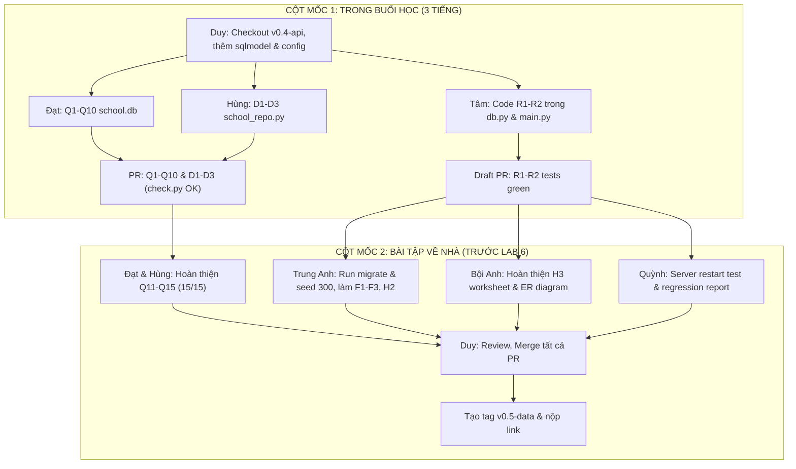

# CSC10014 Lab 5 — Phân công và hướng dẫn triển khai trên `assistant_core_lab` (nhóm 7 người)

> **Bản chuẩn hóa hoàn chỉnh:** Điều chỉnh toàn diện kế hoạch phân công dựa trên tài liệu yêu cầu Lab 5 (`CSC10014_2026_Lab05_Data_SQL_Persistence_Tutorial.docx.pdf`), gói tài nguyên giảng viên cấp (`lab05_resource`) và hiện trạng thực tế của repository `assistant_core_lab` tại tag `v0.4-api`.
>
> **Thành viên nhóm 7:** Duy, Đạt, Hùng, Tâm, Trung Anh, Bội Anh, Quỳnh.
>
> **Repository:** [Computational-Thinking-Project/assistant_core_lab](https://github.com/Computational-Thinking-Project/assistant_core_lab). Baseline bắt đầu: Git tag `v0.4-api` (commit `a9ba3a4`).

---

## 0. Bối cảnh thực tế và nguyên tắc triển khai chuẩn hóa

### 0.1. Hiện trạng thực tế của repository sau khi xác minh
1. **Tag baseline `v0.4-api` đã có sẵn:** Commit `a9ba3a4` kết thúc Lab 4 đã tổ chức code sạch sẽ, gồm `src/assistant_api`, `src/assistant_core`, `tests/`, `api-tests/`.
2. **Hiện trạng persistence tại v0.4:** Trong `src/assistant_api/main.py`, feedback đang được lưu tạm thời bằng một Python list trong bộ nhớ (`feedback_store: list[FeedbackOut] = []` kèm ghi chú rõ ràng: `# Lab 5 replaces this with a database`). Repository hoàn toàn chưa có database nào trước Lab 5.
3. **Vai trò của gói `starter/` trong `lab05_resource`:** Thư mục `lab05_resource/starter` là bản cập nhật khung (scaffolding) do giảng viên cung cấp riêng cho Lab 5. Gói này cung cấp sẵn:
   - Thư viện ORM: `sqlmodel==0.0.22`.
   - Lớp truy xuất dữ liệu: `src/assistant_api/db.py` (khai báo các bảng `ChatSession`, `Interaction`, `Feedback` và lớp `Repository` với hàm `record_interaction`, `intent_stats`, cùng các vị trí TODO `R1`, `R2`).
   - Công cụ di chuyển và tạo dữ liệu: `scripts/migrate.py`, `scripts/seed.py`, `sql/migrations/`.
   - Worksheet thiết kế: `worksheets/data_model.md` và `sql/bad_schema.sql`.

### 0.2. Quy tắc triển khai chuẩn hóa
1. **Dùng đúng công nghệ chỉ định:** Sử dụng `SQLModel` (`sqlmodel==0.0.22`) theo đúng hướng dẫn của tài liệu Lab 5; không tự ý thay thế bằng ORM khác.
2. **Tích hợp trực tiếp vào repo chính:** Tích hợp các file từ `lab05_resource/starter` vào cấu trúc source code của `assistant_core_lab`. Sản phẩm cuối cùng nộp bài là toàn bộ repo `assistant_core_lab` tại tag `v0.5-data`.
3. **Phân ranh rạch ròi giữa bài tập và sản phẩm:** 
   - Phần thực hành `school.db` (Q1–Q15, D1–D3) nằm độc lập trong `lab05_resource/practice/` (hoặc thư mục `lab05/practice/`), tuyệt đối không đưa domain trường học vào `src/` của Assistant.
   - Phần Assistant persistence (`db.py`, migrations, R1–R2, F1–F3, H2) thuộc về `assistant_core_lab`.
4. **Bảo đảm nguyên tắc Data Minimization (Bảo vệ dữ liệu cá nhân):**
   - Tuyệt đối không lưu tên sinh viên, số điện thoại hoặc toàn bộ câu hỏi (raw user message).
   - `session_id` bắt buộc phải được băm (SHA-256) kèm `salt` bí mật lấy từ biến môi trường (`SESSION_SALT`), không hard-code.
5. **Git Hygiene:** Tuyệt đối không commit file database runtime (`*.db`), file `.env`, cache hoặc credentials lên Git.

---

## 1. Mục tiêu và tiêu chí đánh giá theo điểm số

Tổng điểm bài lab là **10 điểm (+1 điểm thưởng)** theo đúng rubric tại trang 20 của tài liệu:

| Hạng mục | Nhiệm vụ | Nơi lưu trữ artifact | Mức điểm | Mốc thời hạn nộp |
|---|---|---|---|---|
| **SQL Practice (Must)** | Q1–Q10 trên `school.db` | `practice/my_answers.sql` (check bằng `check.py`) | **3 điểm** | **Mốc 1:** Cuối buổi thực hành (PR link) |
| **Python SQLite (Must)** | D1–D3 trên `school_repo.py` | `practice/school_repo.py` (pass `test_school_repo.py`) | **2 điểm** | **Mốc 1:** Cuối buổi thực hành (PR link) |
| **Assistant R1–R2 (Must)** | Lưu feedback bền vững, list newest first | `src/assistant_api/db.py`, `main.py` (test xanh, sống sau restart) | **2 điểm** | **Mốc 1:** Cuối buổi thực hành (Draft PR link)<br>**Mốc 2:** Merge hoàn chỉnh |
| **SQL Practice (Should/H1)** | Q11–Q15 (JOIN / LEFT JOIN) | `practice/my_answers.sql` (đạt 15/15 trên `check.py`) | **2 điểm** | **Mốc 2:** 23:59 ngày trước Lab 6 (PR link) |
| **Assistant Analytics (Should)** | F1–F3 hoặc H2 trên Assistant DB | `sql/my_queries.sql` kèm câu hỏi và kết quả thực tế | **1 điểm** | **Mốc 2:** 23:59 ngày trước Lab 6 (PR link) |
| **Bonus Design Review (H3)** | Phân tích 6 lỗi của `bad_schema.sql` và data minimization | `worksheets/data_model.md` | **+1 điểm** | **Mốc 2:** 23:59 ngày trước Lab 6 |
| **Team Release Tag** | Merge toàn bộ và gắn tag release | Git tag `v0.5-data` | Điều kiện cần | **Mốc 2:** 23:59 ngày trước Lab 6 (Tag link) |

### Chi tiết 2 mốc nộp bài (Deadlines)
* **Cột mốc 1 — Cuối buổi thực hành trên lớp (End of Session):**
  1. Link PR nộp `my_answers.sql` (tối thiểu đạt Q1–Q10) + `school_repo.py` (D1–D3 pass tests).
  2. Link Draft PR cho `R1–R2` tích hợp trong `assistant_core_lab` (tests xanh).
* **Cột mốc 2 — Trước buổi học Lab 6 (23:59 the day before Lab 6):**
  1. Link PR hoàn thành H1 (15/15) + H2 (query + output trên `assistant.db`) + Bonus H3 worksheet.
  2. Tech Lead nộp link Git tag `v0.5-data` sau khi đã merge toàn bộ và kiểm thử xanh từ clone sạch.

---

## 2. Bảng phân công chi tiết cho 7 thành viên (Đã tái cân bằng)

Để khắc phục tình trạng người quá ít việc (Hùng làm 3 hàm mất 15 phút), người quá nặng (Đạt làm 15 câu SQL, Tâm ôm toàn bộ persistence), nhóm phân công lại như sau:

| STT | Thành viên | Vai trò | Trách nhiệm chính | Nhiệm vụ hỗ trợ & phối hợp |
|---|---|---|---|---|
| 1 | **Duy** | **Tech Lead & Integration** | - Setup dependency `sqlmodel`, config `database_url`<br>- Tạo branch tích hợp từ `v0.4-api`<br>- Review PR, merge và tạo tag `v0.5-data` | Phối hợp với Quỳnh kiểm thử migration và clean setup |
| 2 | **Đạt** | **SQL Lead (Q1–Q10)** | - Tạo `school.db` bằng `make_school_db.py`<br>- Hoàn thành trọn vẹn Q1–Q10 trong buổi học (ăn chắc 3 điểm) | Phối hợp với Hùng giải quyết Q11–Q15 |
| 3 | **Hùng** | **Python SQLite (D1–D3) & SQL JOINs (Q11–Q15)** | - Hoàn thành D1–D3 trong `school_repo.py`<br>- Pass injection test và `test_school_repo.py`<br>- **Cùng Đạt giải các câu JOIN khó Q11–Q15** để đạt 15/15 | Phụ Đạt kiểm thử `check.py` đạt 15/15 |
| 4 | **Tâm** | **Assistant Persistence (R1–R2 Core)** | - Đưa `src/assistant_api/db.py` vào repo<br>- Hoàn thiện TODO R1 (`add_feedback`) & R2 (`list_feedback`)<br>- Kết nối `Repository` vào `main.py` | Tạo Draft PR xanh ngay trong buổi học |
| 5 | **Trung Anh** | **Data Management & Analytics (F1–F3, H2)** | - Tích hợp `scripts/migrate.py`, `scripts/seed.py`<br>- Chạy migration và seed 300 records vào `assistant.db`<br>- Viết query F1–F3 và H2 vào `sql/my_queries.sql` | Cung cấp database mẫu cho nhóm kiểm thử query |
| 6 | **Bội Anh** | **Data Privacy & Schema Review (H3 Bonus)** | - Hoàn thiện `worksheets/data_model.md` (+1 điểm thưởng)<br>- Chỉ ra 6 lỗi của `bad_schema.sql`<br>- Vẽ ER Diagram (Mermaid) và audit data minimization | Review PR của Tâm để chặn rò rỉ dữ liệu cá nhân (PII) |
| 7 | **Quỳnh** | **QA, Regression & Persistence Verification** | - Chạy baseline tests v0.4 và kiểm tra regression<br>- **Test kịch bản Server Restart** (dữ liệu sống sót qua restart uvicorn)<br>- Xây dựng Test Matrix và bằng chứng kiểm thử | Kiểm tra hygiene: chặn commit file `.db` và `.env` |

---

## 3. Hướng dẫn chi tiết từng thành viên

---

### Thành viên 1 — Duy: Tech Lead, Setup & Integration

#### Mục tiêu
Khởi tạo nền tảng persistence, cấu hình môi trường chuẩn, quản lý branch/PR và phát hành tag `v0.5-data`.

#### Các bước thực hiện
1. **Khởi tạo nhánh tích hợp từ đúng baseline:**
   ```bash
   git fetch --all --tags
   git checkout tags/v0.4-api -b integration/lab05-v0.5
   ```
2. **Cập nhật cấu hình phụ thuộc:**
   - Thêm `sqlmodel==0.0.22` vào cả `requirements.txt` và `pyproject.toml` (trong mục `dependencies`).
   - Cài đặt môi trường: `pip install -r requirements.txt`.
3. **Cập nhật `src/assistant_core/config.py`:**
   - Thêm vào class `Settings`:
     ```python
     database_url: str = "sqlite:///assistant.db"
     session_salt: str = Field(default="dev-salt", repr=False)
     ```
   - Đọc từ biến môi trường tương ứng: `DATABASE_URL` và `SESSION_SALT`.
   - Cập nhật `.env.example`:
     ```bash
     DATABASE_URL=sqlite:///assistant.db
     SESSION_SALT=dev-salt-csc10014
     ```
4. **Phối hợp và Merge:**
   - Review và duyệt Draft PR R1–R2 của Tâm trong buổi thực hành.
   - Trước hạn chót Mốc 2: merge toàn bộ PR (`task/sql-practice`, `feature/assistant-persistence`, `task/assistant-analytics`, `docs/schema-design-review`).
   - Xác nhận clone sạch chạy `pytest -q` pass 100%.
   - Tạo tag release và push:
     ```bash
     git tag v0.5-data
     git push origin v0.5-data
     ```

---

### Thành viên 2 — Đạt: SQL Practice Lead (Q1–Q10)

#### Mục tiêu
Nắm vững cú pháp SQL cơ bản trên `school.db`, đạt chuẩn đầu ra Q1–Q10 ngay trong buổi thực hành (3 điểm Must).

#### Các bước thực hiện
1. **Khởi tạo database thực hành:**
   - Mở thư mục `lab05_resource/practice/`.
   - Chạy lệnh: `python make_school_db.py` để tạo `school.db` (gồm 3 bảng: `students`, `courses`, `enrollments`).
   - Dùng DB Browser for SQLite hoặc SQLite Viewer để khảo sát schema và dữ liệu.
2. **Thực hiện Q1–Q10 trong `practice/my_answers.sql`:**
   - Q1–Q2: `SELECT *`, `SELECT name, year FROM students`.
   - Q3–Q4: Điều kiện lọc `WHERE program = 'CS'`, `WHERE year >= 3`.
   - Q5–Q6: Sắp xếp `ORDER BY name DESC`, `ORDER BY title`.
   - Q7–Q9: Tính toán `COUNT(*)`, `GROUP BY program`, `ROUND(AVG(grade), 2)`.
   - Q10: Xử lý giá trị rỗng `WHERE grade IS NULL ORDER BY student_id`.
3. **Kiểm tra tự động:**
   ```bash
   python check.py
   ```
   - Đảm bảo từ Q1 đến Q10 đều hiển thị `OK`.
4. **Hỗ trợ nộp Mốc 1:** Tạo PR chứa `my_answers.sql` (Q1–Q10) cùng với phần D1–D3 của Hùng để kịp nộp cuối buổi.
5. **Phối hợp Mốc 2:** Cùng Hùng hoàn thành các câu Q11–Q15 để đạt trọn vẹn 15/15.

---

### Thành viên 3 — Hùng: Python SQLite (D1–D3) & SQL JOINs (Q11–Q15)

#### Mục tiêu
Thực hiện các thao tác SQLite an toàn trong Python (tránh SQL injection) và phối hợp với Đạt giải quyết các câu JOIN nâng cao.

#### Các bước thực hiện
1. **Hoàn thiện D1–D3 trong `practice/school_repo.py` (Mốc 1):**
   - **D1 — `add_student(con, name, year, program) -> int`:**
     - Dùng parameterized query: `INSERT INTO students (name, year, program) VALUES (?, ?, ?)`.
     - Gọi `con.commit()` và trả về `cur.lastrowid`.
   - **D2 — `average_grade(con, code) -> float | None`:**
     - Query: `SELECT AVG(grade) FROM enrollments WHERE course_code = ?`.
     - Lấy kết quả bằng `fetchone()[0]`. Nếu có giá trị thì `round(val, 2)`, nếu không thì trả về `None`.
   - **D3 — `transcript(con, student_id) -> list`:**
     - JOIN giữa `enrollments` và `courses` theo `course_code = code`.
     - Lọc `WHERE student_id = ?` và `ORDER BY title`.
     - Trả về danh sách tuple `(title, credits, grade)`.
2. **Kiểm thử Python D1–D3:**
   ```bash
   pytest -q test_school_repo.py
   ```
   - Xác nhận 5/5 test pass, đặc biệt là `test_d1_no_sql_injection`.
3. **Cùng Đạt giải quyết Q11–Q15 trong `my_answers.sql` (Mốc 2):**
   - Q11: JOIN giữa `students` và `enrollments` có điều kiện điểm không NULL.
   - Q12: Đếm số lượng sinh viên theo môn học (`GROUP BY c.title ORDER BY COUNT(*) DESC, c.title`).
   - Q13: Sinh viên có điểm dưới 5 (`grade < 5`).
   - Q14: JOIN 3 bảng tính tổng số tín chỉ tích lũy (`SUM(c.credits)`).
   - Q15: `LEFT JOIN` tìm sinh viên chưa đăng ký môn CSC10014 (`WHERE e.student_id IS NULL`).
4. Chạy `python check.py` đạt **15/15**.

---

### Thành viên 4 — Tâm: Assistant Persistence Implementation (R1–R2 Core)

#### Mục tiêu
Triển khai lưu trữ bền vững cho Assistant trong `assistant_core_lab` bằng SQLModel, kết nối API và đảm bảo bài test restart pass.

#### Các bước thực hiện
1. **Tích hợp `src/assistant_api/db.py`:**
   - Sao chép file mẫu từ `lab05_resource/starter/src/assistant_api/db.py` vào `src/assistant_api/`.
   - File đã chứa sẵn cấu trúc:
     - `ChatSession`: lưu `id` (salted hash), `channel`, `created_at`.
     - `Interaction`: lưu metadata tương tác (`request_id`, `session_id`, `intent`, `topic`, `latency_ms`...).
     - `Feedback`: lưu `id`, `request_id`, `rating`, `comment`, `created_at`.
     - `record_interaction`: ghi nhận tương tác sau mỗi lượt chat.
2. **Triển khai TODO R1 (`add_feedback`):**
   ```python
   def add_feedback(self, request_id: str, rating: int, comment: str | None) -> Feedback | None:
       with Session(self.engine) as db:
           exists = db.exec(select(Interaction).where(Interaction.request_id == request_id)).first()
           if exists is None:
               return None  # API sẽ chuyển thành HTTP 404
           fb = Feedback(request_id=request_id, rating=rating, comment=comment)
           db.add(fb)
           db.commit()
           db.refresh(fb)
           return fb
   ```
3. **Triển khai TODO R2 (`list_feedback`):**
   ```python
   def list_feedback(self, limit: int = 100) -> list[Feedback]:
       with Session(self.engine) as db:
           stmt = select(Feedback).order_by(Feedback.created_at.desc()).limit(limit)
           return list(db.exec(stmt))
   ```
4. **Cập nhật `src/assistant_api/main.py`:**
   - Trong `create_app()`: khởi tạo `Repository(engine, settings.session_salt)`.
   - Trong `POST /v1/chat`: ghi lại interaction qua `repo.record_interaction(...)`.
   - Trong `POST /v1/feedback`: gọi `repo.add_feedback(...)`, nếu trả về `None` thì raise `HTTPException(404, "Unknown request id")`.
   - Trong `GET /v1/feedback`: gọi `repo.list_feedback(limit)`.
5. **Kiểm thử và mở Draft PR (Mốc 1):**
   - Chạy `pytest -q tests/test_db.py tests/test_api.py`.
   - Mở Draft PR `feature/assistant-persistence` ngay cuối buổi học.

---

### Thành viên 5 — Trung Anh: Data Management & Analytics (F1–F3, H2)

#### Mục tiêu
Quản lý công cụ migration/seed dữ liệu và thực hiện các câu truy vấn phân tích kinh doanh trên cơ sở dữ liệu thật của Assistant.

#### Các bước thực hiện
1. **Tích hợp các script dữ liệu:**
   - Đưa `lab05_resource/starter/scripts/migrate.py` và `seed.py` vào thư mục `scripts/` của repo.
   - Đưa các file migration `001_init.sql`, `002_add_faq.sql` vào `sql/migrations/`.
2. **Chạy Migration & Seeding:**
   ```bash
   python scripts/migrate.py assistant.db
   python scripts/seed.py assistant.db 300
   ```
   - Xác nhận `assistant.db` đã được nạp 300 tương tác mẫu.
3. **Thực hiện truy vấn trong `sql/my_queries.sql`:**
   - **F1:** Đếm số câu hỏi theo intent:
     ```sql
     SELECT intent, COUNT(*) AS requests FROM interaction GROUP BY intent ORDER BY requests DESC;
     ```
   - **F2:** Thời gian phản hồi trung bình theo intent:
     ```sql
     SELECT intent, ROUND(AVG(latency_ms), 1) AS avg_ms FROM interaction GROUP BY intent;
     ```
   - **F3:** Chủ đề nhận nhiều đánh giá tiêu cực nhất (thumbs-down):
     ```sql
     SELECT i.topic, COUNT(*) AS thumbs_down
     FROM feedback f
     JOIN interaction i ON f.request_id = i.request_id
     WHERE f.rating = -1
     GROUP BY i.topic
     ORDER BY thumbs_down DESC;
     ```
   - **H2 (Homework):** Đặt câu hỏi thực tế hữu ích, viết query và xuất output:
     - *Ví dụ câu hỏi:* Tỷ lệ các phản hồi bị xuống cấp (degraded/fallback) theo từng intent? Hoặc khung giờ nào trong ngày có lượng câu hỏi cao nhất?
     - Ghi rõ: Câu hỏi, mã SQL và bảng kết quả chạy thực tế trên `assistant.db`.
4. Tạo PR `task/assistant-analytics` cho Mốc 2.

---

### Thành viên 6 — Bội Anh: Data Privacy & Schema Review (H3 Bonus)

#### Mục tiêu
Bảo đảm tính tuân thủ quyền riêng tư dữ liệu theo luật và hoàn thành bài tập phân tích thiết kế H3 để lấy trọn **+1 điểm thưởng**.

#### Các bước thực hiện
1. **Hoàn thành Worksheet `worksheets/data_model.md` (H3 Bonus):**
   - **Phần 1: Phân tích 6 vấn đề trong `sql/bad_schema.sql`:**
     1. `student_name`, `student_phone`: Lưu trữ PII không cần thiết cho tính năng trợ lý.
     2. `message`: Lưu toàn bộ raw text câu hỏi, vi phạm Data Minimization và rủi ro rò rỉ thông tin cá nhân.
     3. `intent`: Dữ liệu tự do, không chuẩn hóa, khó thống kê.
     4. `time`: Lưu string định dạng người đọc (`'5/10/2026 9:03 PM'`), không thể sắp xếp/truy vấn theo thời gian.
     5. `feedback`: Chuỗi `'1,-1,1'` vi phạm dạng chuẩn 1 (1NF), không thể dùng SQL aggregation.
     6. `latency`: Chuỗi văn bản `'120ms'` thay vì số thực, không tính được `AVG`/`SUM`.
     7. Cột `id` không khai báo `PRIMARY KEY`.
   - **Phần 2: Bảng phân loại lưu trữ (Store or Not Table):**
     - Điền rõ lý do lưu/không lưu, hình thức lưu (raw/hashed) và retention cho từng loại dữ liệu.
   - **Phần 3: Câu hỏi sản phẩm và trường dữ liệu tương ứng.**
   - **Phần 4: Vẽ sơ đồ ER Diagram (Mermaid):** Biểu diễn quan hệ 1-N giữa `chat_session` → `interaction` → `feedback`.
2. **Audit mã nguồn của nhóm (Privacy Review):**
   - Kiểm tra code của Tâm: đảm bảo không có route nào nhận hoặc log câu hỏi gốc của user.
   - Xác nhận `session_id` được băm trước khi insert vào bảng `chat_session`.
   - Đảm bảo feedback chỉ được thêm khi có `request_id` hợp lệ (chống orphan records).

---

### Thành viên 7 — Quỳnh: QA, Regression & Persistence Verification

#### Mục tiêu
Đảm bảo toàn bộ test case của v0.4 không bị ảnh hưởng (regression) và chứng minh feedback tồn tại bền vững qua restart.

#### Các bước thực hiện
1. **Kiểm thử Baseline (Giai đoạn đầu):**
   - Chạy test toàn bộ hệ thống v0.4 tại commit `a9ba3a4` để ghi nhận baseline test report.
2. **Xây dựng Test Matrix cho R1–R2:**

   | Kịch bản kiểm thử | Dữ liệu đầu vào | Kết quả mong đợi |
   |---|---|---|
   | Gửi feedback hợp lệ | `request_id` vừa chat sinh ra, `rating: 1` | HTTP 201, trả về object feedback kèm ID |
   | Gửi feedback cho ID ảo | `request_id: "fake-uuid-999"` | HTTP 404 (`Unknown request id`), không lưu vào DB |
   | Lấy danh sách feedback | Query param `limit=10` | Sắp xếp giảm dần theo thời gian (`created_at DESC`) |
   | **Server Restart Verification** | Gửi feedback → Kill uvicorn → Khởi động lại → GET list | **Dữ liệu feedback vẫn còn nguyên vẹn** |
   | Kiểm tra PII trong DB | Mở `assistant.db` bằng DB Browser | Không có cột lưu tên, SĐT hay nội dung câu hỏi |

3. **Thực hiện kiểm thử thực tế Server Restart:**
   - Chạy uvicorn: `uvicorn assistant_api.main:create_app --factory`.
   - Dùng Postman hoặc curl gọi `/v1/chat`, lấy `request_id`.
   - Gửi feedback với `request_id` đó (nhận 201).
   - Nhấn `Ctrl+C` dừng server.
   - Khởi động lại uvicorn và gọi `GET /v1/feedback` (với admin API key) → Xác nhận bản ghi vẫn còn.
4. **Git Hygiene Audit:**
   - Kiểm tra `git status` trước khi release: đảm bảo không ai commit file `.db`, `.env` hoặc thư mục cache.

---

## 4. Trình tự thực hiện và phối hợp theo 2 cột mốc



---

## 5. Quy định Git Workflow & Branch Naming

* **Branch chính:** `main` (không commit trực tiếp).
* **Branch tích hợp:** `integration/lab05-v0.5` (tạo từ tag `v0.4-api`).
* **Các nhánh tính năng:**
  - `task/sql-practice`: Đạt & Hùng (bài tập SQL `school.db`).
  - `task/python-sqlite-practice`: Hùng (bài tập `school_repo.py`).
  - `feature/assistant-persistence`: Tâm (triển khai R1–R2).
  - `task/assistant-analytics`: Trung Anh (migration, seed, F1–F3, H2).
  - `docs/schema-design-review`: Bội Anh (H3 worksheet, diagrams).
  - `test/lab05-qa`: Quỳnh (QA report, test evidence).

---

## 6. Checklist nghiệm thu bài nộp

### Trong buổi học (Mốc 1):
- [ ] `practice/my_answers.sql` hoàn thành tối thiểu Q1–Q10.
- [ ] `practice/school_repo.py` hoàn thành D1–D3, test injection pass.
- [ ] Nộp link PR bài tập thực hành lên LMS.
- [ ] Mở Draft PR `feature/assistant-persistence` có R1–R2 pass test.
- [ ] Nộp link Draft PR lên LMS.

### Trước buổi Lab 6 (Mốc 2):
- [ ] `practice/my_answers.sql` đạt 15/15 khi chạy `python check.py`.
- [ ] `sql/my_queries.sql` hoàn thành F1–F3 và H2 có kèm kết quả thực tế.
- [ ] `worksheets/data_model.md` hoàn thành đầy đủ 4 phần (H3 Bonus).
- [ ] Quỳnh hoàn thành test restart server (dữ liệu không mất khi tắt app).
- [ ] Toàn bộ PR được merge sạch sẽ vào `integration/lab05-v0.5`.
- [ ] Tag `v0.5-data` được tạo và push lên GitHub.
- [ ] Tech Lead nộp link tag và link PR hoàn thiện lên LMS.
